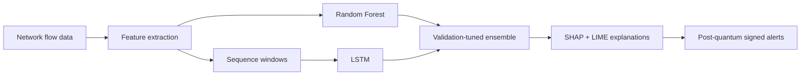
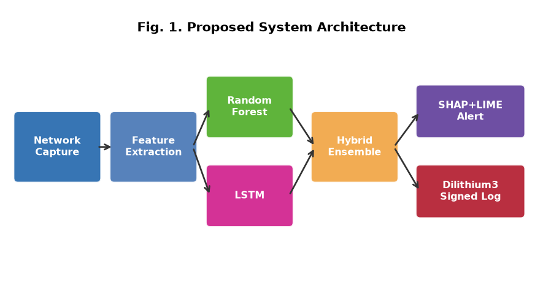
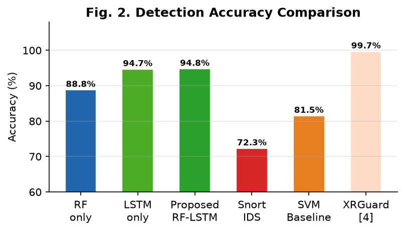
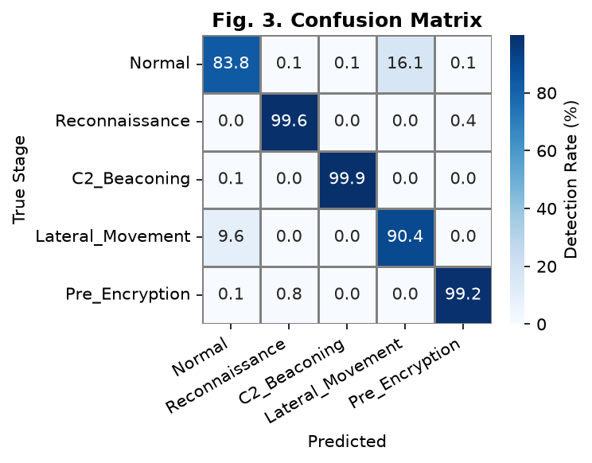
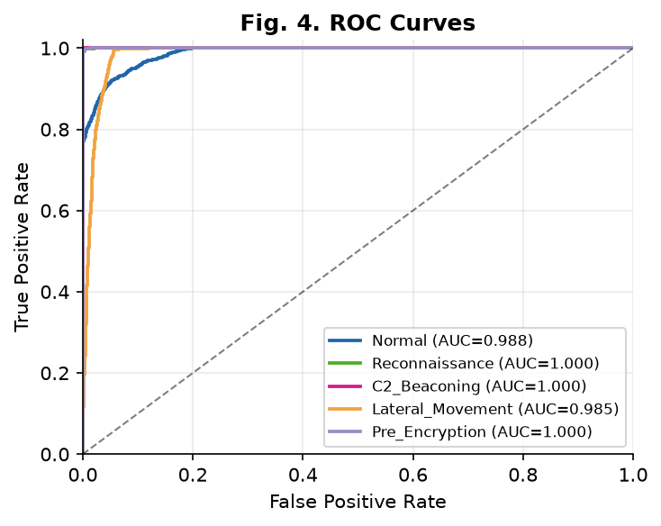
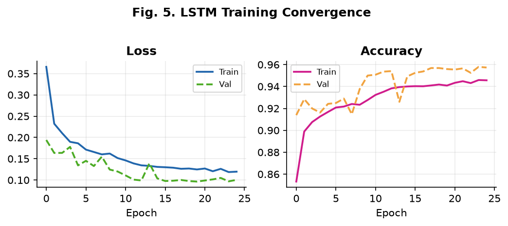
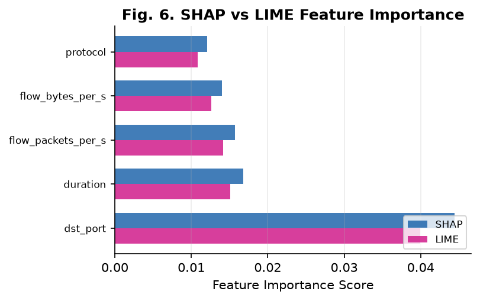

# Ransomware Kill-Chain Detection

> Hybrid RF-LSTM intrusion detection with explainable alerts and post-quantum protection.

[](https://www.python.org/)
[](LICENSE)
[](#status)

This project detects ransomware progression in network-flow data across five
kill-chain stages. It combines a Random Forest for tabular flow features with
an LSTM for temporal sequences, tunes their ensemble weight on validation data,
explains predictions with SHAP and LIME, and signs generated alerts with
ML-DSA-65 and ML-KEM-768.

## Dataset

The pipeline uses the [CIC-IDS2018 dataset](https://www.unb.ca/cic/datasets/ids-2018.html)
from the Canadian Institute for Cybersecurity. The project expects the
preprocessed flow file `data/network_traffic.csv`; `load_cic.py` and
`src/cic_loader.py` map CIC-IDS2018 fields and labels into the 17 project
features and five kill-chain stages used by the models.

The original `*TrafficForML_CICFlowMeter.csv` exports are not included in this
repository because they are multi-gigabyte files and exceed GitHub file-size
limits. Download the source data separately, then run the loader to recreate
the prepared input locally.

## Pipeline



### Detection stages

| Class | Stage | Severity |
|---:|---|---|
| 0 | Normal | None |
| 1 | Reconnaissance | Low |
| 2 | C2 beaconing | Medium |
| 3 | Lateral movement | High |
| 4 | Pre-encryption | Critical |

## Visual results

The generated figures are kept in [`output/figures/`](output/figures/):

| Architecture | Accuracy comparison | Confusion matrix |
|---|---|---|
|  |  |  |

| ROC curves | Training convergence | Explainability |
|---|---|---|
|  |  |  |

## Quick start

Use Python 3.11 or newer:

```powershell
py -3.11 -m venv .venv
.venv\Scripts\Activate.ps1
py -3.11 -m pip install -r requirements.txt
py -3.11 main.py
```

The full pipeline expects `data/network_traffic.csv`. The original CIC-IDS2018
raw exports are intentionally not committed because some files exceed GitHub's
file-size limits. Place the prepared dataset and any locally generated model
artifacts under `data/` and `output/` before running.

## Repository layout

```text
.
├── config.py                 # Features, labels, paths, and hyperparameters
├── main.py                   # End-to-end training and evaluation pipeline
├── src/
│   ├── build_dataset.py      # Dataset loading and sequence construction
│   ├── models/               # RF, LSTM, and ensemble models
│   ├── explainability.py     # SHAP and LIME explanations
│   ├── alert_system.py       # Alert generation and signed logs
│   ├── pqc/                  # ML-DSA and ML-KEM integration
│   └── visualizations.py     # Publication-ready figures
├── output/figures/           # Curated visual outputs
├── requirements.txt
└── test_pqc.py
```

## Supporting scripts

* `load_cic.py` prepares network-flow data.
* `final_eval.py` runs final evaluation.
* `tune_rf.py` tunes Random Forest settings.
* `pqc_bench.py` benchmarks post-quantum operations.
* `test_pqc.py` checks alert signing and verification.

## Status

This is a research prototype for defensive network-security experimentation.
Validate models, cryptographic integrations, and alert handling in an isolated
environment before using them in production.

## License

Copyright © 2026 Hari Saravanan M.

Licensed under the Apache License, Version 2.0. See [`LICENSE`](LICENSE) for
the full text.
